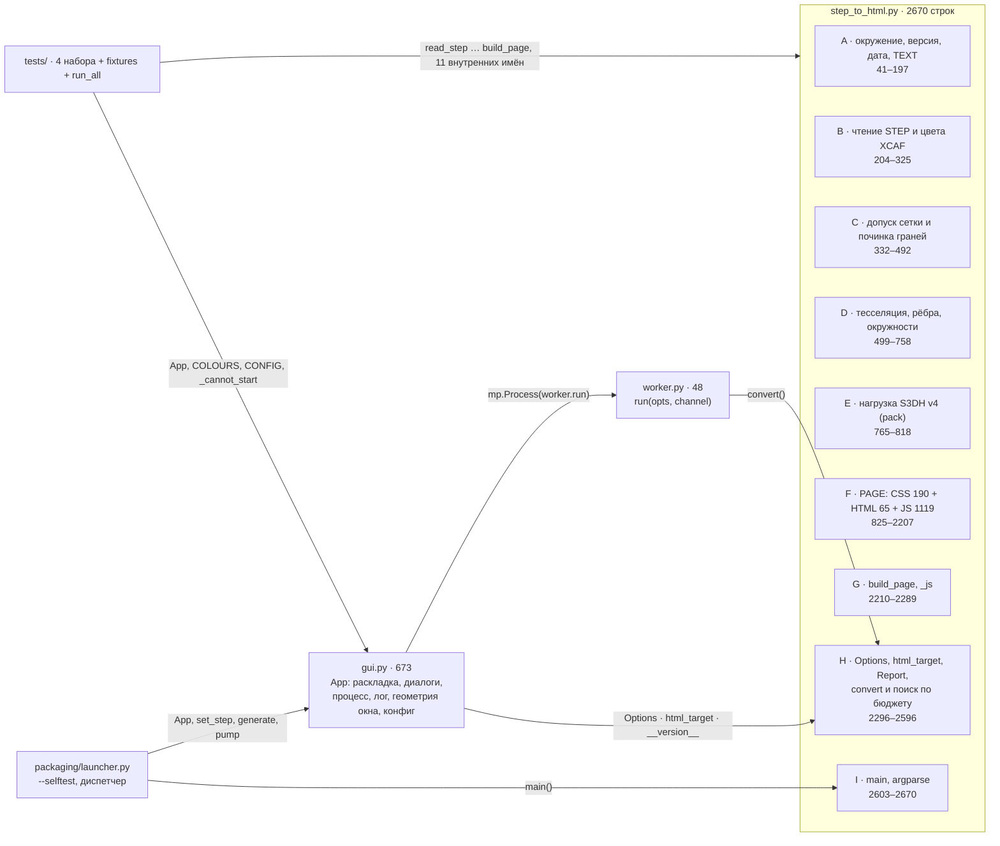
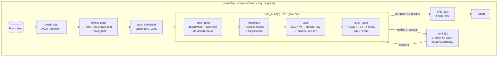
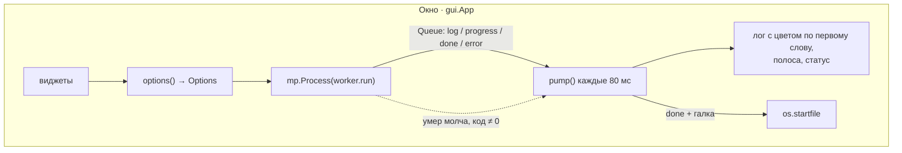
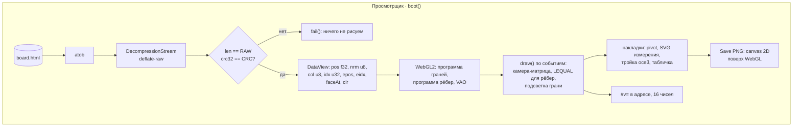

# Архитектура step2html — как есть на 0.9.6

Снято 2 сентября 2026. Два вопроса: из чего это состоит (структура) и как
через это идёт работа (функция). Третий — что здесь монолит, а что можно
унести в другой проект как есть — в конце.

## Структурная схема

Три исполняемых файла, один из которых — 2670 строк и несёт в себе
одиннадцать разных вещей.

Что видно по стрелкам: окно и воркер зависят только от секции H (и от
`__version__`), то есть граница между интерфейсом и конвейером уже
проведена — `Options` внутрь, `Report` наружу, `log`/`progress` как
колбэки. Зато тесты тянутся к одиннадцати внутренним именам сразу из
пяти секций: они тестируют не API, а внутренности, и при дроблении именно
они будут ломаться первыми. Это не аргумент против дробления — это
аргумент за шаг «тесты сначала» (план М5).

## Функциональная схема

Три независимых дорожки: конвейер в Python, окно с дочерним процессом,
и просмотрщик в браузере. Единственное, что связывает первую и третью, —
формат `S3DH` v4 и шаблон `PAGE`.

## Что монолит, а что переиспользуемо

Критерий монолита здесь — не размер, а **сколько разных причин меняться
собрано в одном месте** и **можно ли проверить часть, не поднимая всё**.

| Код | Строк | Причин меняться | Проверяется отдельно? | Вердикт |
|---|---|---|---|---|
| `step_to_html.py` целиком | 2670 | 11 (формат, шейдер, CSS, XCAF, мешер, поиск, CLI…) | нет — любой тест тянет OCP | **Монолит М1** |
| `PAGE`, функция `boot()` | 1119 JS | 9 (рендер, камера, ввод, выбор, измерение, привязка, PNG, раскладка, адрес) | нет — 40 замыканий на общие `let` | **Монолит М2** |
| `convert()` | 230 | 5 (валидация, прогресс, поиск, запись, лог) | нет — поиск по бюджету без STEP не запустить | **Монолит М3** |
| `gui.App` | 560 | 5 (раскладка, процесс, лог, геометрия, конфиг) | частично — только через полный прогон | **Монолит М4** |
| `tests/` | 935 | — | — | дубли `check()` ×4, `_faces`, `_area` — **М5** |
| README.md | 1444 | 2 языка × 3 жанра (руководство, журнал решений, журнал ревью) | — | **М6**: каждая правка пишется дважды |

Переиспользуемое — как есть или с одним швом:

| Кусок | Где | Что нужно, чтобы унести |
|---|---|---|
| `html_target(out, step)` | H | ничего, чистая функция |
| `build_page` / `_js` — подстановка одним проходом | G | ничего |
| Обход XCAF с цветами: `collect_parts`, `get_color`, `instance_color`, `_srgb_byte`, `label_name` | B | ничего; это готовый «прочитай STEP с цветами» для любого OCP-проекта |
| Починка: `_patch_face`, `repair_parts`, `_empty_faces`, `_meshed_ok` | C | ничего |
| `collect_edges` — рёбра из `Poly_PolygonOnTriangulation` + `note_circle` | D | принимает `parts`; шов — заменить `color_tool` на `colour_of(face)` |
| `tessellate` | D | тот же шов `colour_of(face)` |
| Формат `S3DH` + `pack` | E | нужен парный `unpack` в Python (сейчас читалка есть только в JS и inline в `test_page.py`) |
| Поиск по бюджету (степенной закон, отказ дыр) | H, внутри `convert` | вынуть в функцию `search(build, budget)` — становится чистой и тестируемой без OCP |
| `phase()` — одна полоса на сборку с весами фаз | H | то же |
| JS: `mul/rotX/rotY/orthonormalise`, `basis/VIEWS/fitDist`, `pick`, `snapAt/rimPath`, `paintSvgOnto/savePng`, `chooseLayout`, `rememberView/restoreView` | F | вынуть из `boot()`, передавать состояние явно |
| `_cannot_start`, `severity_of` + `COLOURS`, `_virtual_screen/_reachable`, цикл `generate/cancel/pump/_finish`, `_load_config/save_config` | gui | вынуть из класса |
| `worker.run` | worker | ничего |
| `fixtures.coloured_assembly` | tests | ничего; это готовая цветная STEP-фикстура для любого OCP-теста |
| `launcher.selftest`, spec с заметкой про VTK | packaging | ничего |

Целевая структура и порядок работ — в [refactoring-plan.md](refactoring-plan.md).
